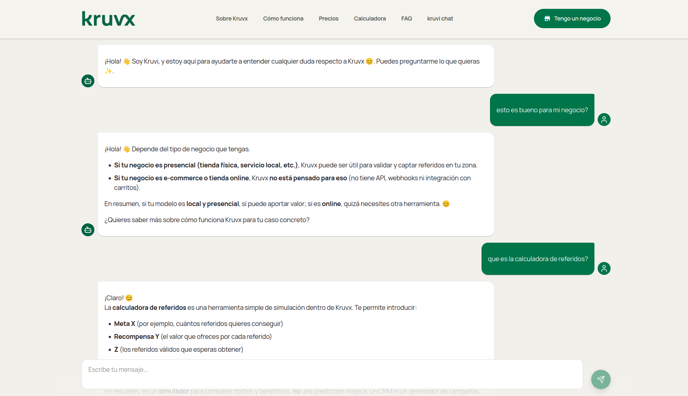

# 🤖 Kruvx RAG Chat — Open Source Template

> **Un RAG (Retrieval-Augmented Generation) listo para producción** construido con [Reflex](https://reflex.dev), potenciado por **NVIDIA Nemotron** y **TF-IDF + Cosine Similarity**. Diseñado para que cualquiera pueda adaptarlo cambiando solo la **interfaz** y el **archivo Markdown** de conocimiento.

[](https://python.org)
[](https://reflex.dev)
[](LICENSE)
[](https://www.nvidia.com/en-us/ai/)

---

## 🎯 ¿Qué es este proyecto?

Este es el **RAG real que uso en mi SaaS [Kruvx](https://kruvx.cloud)** (asistente "Kruvi"), liberado como plantilla open source. Permite crear un chat inteligente especializado en **cualquier dominio** simplemente:

1. 🎨 **Modificando la interfaz** (componentes Reflex en `rag_app_kruvx/components/`)
2. 📝 **Reemplazando `assets/tu-documentacion.md`** con tu propia base de conocimiento

> **No necesitas saber ML, embeddings, vector databases, ni LangChain.** El motor RAG usa **TF-IDF + scikit-learn** (ligero, cero dependencias pesadas, funciona en CPU).

---

## ✨ Características Principales

### 🧠 Motor RAG Ligero (TF-IDF + Cosine Similarity)
- **Chunking semántico** por headers Markdown (`#`, `##`, `###`)
- **Vectorización TF-IDF** con n-gramas (1,2) para capturar frases
- **Recuperación top-k** con umbral de similitud configurable
- **Inicialización eager** en arranque (sin latencia en primera request)

### 🛡️ Capas de Protección (Production-Ready)
| Capa | Qué hace |
|------|----------|
| **Rate Limiting** | 10 req/min, 50 req/hora, 200 req/día por sesión |
| **Budget Tracking** | Límite de tokens (50k) y caracteres (100k) por sesión |
| **Debounce** | Mínimo 2s entre requests |
| **Input Validation** | Longitud (2-2000 chars) + detección de *prompt injection* |
| **Response Cache** | TTL 1h, máx 50 entradas (evita calls repetidos a la API) |
| **Guardrail de Dominio** | Keyword allowlist/denylist para rechazar off-topic **sin llamar a la LLM** |

### 🎨 Design System Kruvx (Pixel-Perfect)
- **Navbar & Footer** idénticos a `kruvx.cloud` (basados en `base.html` real)
- **Tailwind v4** con tokens de diseño exactos (colores, spacing, tipografía, sombras)
- **Componentes reutilizables**: Botones, Cards, Inputs, Alerts, Frap button
- **Fuentes**: Manrope (UI) + Literata (Display) + Material Symbols Outlined
- **Dark/Light** listo, responsive mobile-first

### 💬 Chat Streaming en Tiempo Real
- **Streaming token-by-token** desde NVIDIA API
- **Efecto "typing"** para respuestas cached y welcome message
- **Auto-scroll** suave al final
- **Estados visuales**: loading spinner, disabled input, error handling

---

## 🖼️ Demo Visual



*Interfaz de chat full-screen con navbar Kruvx, streaming en tiempo real, y burbujas de mensaje con diseño system.*

---

## 🏗️ Arquitectura del Proyecto

```
rag_app_kruvx/
├── 📁 assets/
│   ├── kruvx-guia-usuario.md     # ← TU BASE DE CONOCIMIENTO (cámbiala)
│   ├── chat.png                   # Imagen para README
│   ├── kruvx_logo.png             # Logo para navbar
│   ├── styles.css                 # Estilos globales extra
│   └── favicon.ico / icon-192.png / site.webmanifest
│
├── 📁 rag_app_kruvx/
│   ├── __init__.py
│   ├── rag_app_kruvx.py          # App entry point + routing
│   ├── rxconfig.py               # Config Reflex + Tailwind v4 COMPLETO
│   ├── state.py                  # ChatState (streaming + protecciones + RAG)
│   ├── rag_engine.py             # RAGEngine (TF-IDF + guardrail)
│   │
│   └── 📁 components/
│       ├── __init__.py
│       ├── layout.py             # Navbar, Footer, Page Layouts
│       ├── chat.py               # Chat UI (burbujas, input, container)
│       └── ui.py                 # Design System (botones, cards, inputs, etc.)
│
├── pyproject.toml                # Dependencias + metadatos
├── requirements.txt              # Lock file (uv)
├── uv.lock                       # Lock file (uv)
└── README.md                     # Este archivo
```

### Flujo de Datos

```
Usuario envía mensaje
       │
       ▼
┌──────────────────┐
│ Input Validation │ ──❌→ Error "Mensaje muy corto/largo/inválido"
└────────┬─────────┘
         │ ✅
         ▼
┌──────────────────┐
│   Rate Limit     │ ──❌→ Error "Demasiados mensajes / límite diario"
└────────┬─────────┘
         │ ✅
         ▼
┌──────────────────┐
│    Debounce      │ ──❌→ Error "Espera un momento"
└────────┬─────────┘
         │ ✅
         ▼
┌──────────────────┐
│   Budget Check   │ ──❌→ Error "Límite de uso alcanzado"
└────────┬─────────┘
         │ ✅
         ▼
┌──────────────────┐
│   Cache Check    │ ──✅ (hit) → Stream cached response
└────────┬─────────┘
         │ ✅ (miss)
         ▼
┌──────────────────┐
│  Guardrail:      │ ──❌ (off-topic) → Respuesta fija sin API call
│  is_kruvx_related│
└────────┬─────────┘
         │ ✅ (on-topic)
         ▼
┌──────────────────┐
│  RAG Retrieval   │ ── get_context(query) → top-k chunks
│  (TF-IDF)        │
└────────┬─────────┘
         │
         ▼
┌──────────────────┐
│  NVIDIA API      │ ── Streaming response (Nemotron 3 Ultra)
│  (OpenAI compat) │
└────────┬─────────┘
         │
         ▼
┌──────────────────┐
│  Post-process:   │
│  - Record request│
│  - Update budget │
│  - Store cache   │
└──────────────────┘
```

---

## 🚀 Quick Start

### Prerrequisitos
- **Python 3.12+**
- **uv** (recomendado) o pip
- **NVIDIA API Key** (gratis en [build.nvidia.com](https://build.nvidia.com/explore/discover))

### Instalación

```bash
# 1. Clona el repo
git clone https://github.com/tu-usuario/rag-app-kruvx.git
cd rag-app-kruvx

# 2. Crea entorno virtual e instala (con uv - rápido)
uv sync

# O con pip tradicional
python -m venv .venv
source .venv/bin/activate  # Linux/Mac
# .venv\Scripts\activate   # Windows
pip install -r requirements.txt

# 3. Configura variables de entorno
cp .env.example .env  # Si existe, o crea uno nuevo
```

### Variables de Entorno (`.env`)

```bash
# ⚠️ OBLIGATORIO - Consíguelo gratis en https://build.nvidia.com
NVIDIA_API_KEY=tu_api_key_aqui

# Opcionales (tienen defaults)
NVIDIA_BASE_URL=https://integrate.api.nvidia.com/v1
NVIDIA_MODEL=nvidia/nemotron-3-nano-omni-30b-a3b-reasoning
```

> **Modelos NVIDIA recomendados** (gratis con rate limits generosos):
> - `nvidia/nemotron-3-nano-omni-30b-a3b-reasoning` (default, rápido)
> - `nvidia/nemotron-3-ultra-550b-a55b` (más capaz, más lento)

### Ejecutar en Desarrollo

```bash
# Compila frontend + inicia backend (hot reload)
reflex run

# O solo backend (si ya compilaste frontend)
reflex run --backend-only
```

Abre **http://localhost:3000** 🎉

### Compilar para Producción

```bash
# Genera build optimizado en .web/
reflex build

# Ejecuta en modo producción (gunicorn + granian)
reflex run --env prod
```

---

## 🔧 Personalización: Hazlo Tuyo en 2 Pasos

### 1️⃣ Cambia la Base de Conocimiento

Reemplaza **`assets/kruvx-guia-usuario.md`** con tu propio archivo Markdown:

```bash
# Ejemplo: documentación de tu producto, FAQ, manual, etc.
cp mi-documentacion.md assets/mi-documentacion.md
```

**Luego actualiza la ruta en `rag_engine.py`:**

```python
# Línea ~26 en rag_engine.py
DOC_PATH = Path(__file__).parent.parent / "assets" / "mi-documentacion.md"
```

**Ajusta keywords del guardrail** (líneas 29-72 en `rag_engine.py`):

```python
# Palabras que indican que la pregunta SÍ es de tu dominio
TU_DOMINIO_KEYWORDS = {
    "tu_producto", "tu_marca", "caracteristica_x", "precio", "plan",
    "soporte", "faq", "como", "que", "cuando", "donde", "porque",
    # ... añade términos de TU dominio
}

# Palabras que indican que NO es de tu dominio (rechazo rápido)
NON_TU_DOMINIO_KEYWORDS = {
    "futbol", "deporte", "politica", "receta", "cine", "musica",
    "programacion", "python", "javascript", "viaje", "salud", "finanzas",
    # ... añade temas que NO quieres contestar
}
```

> **Tip:** El guardrail usa coincidencia simple de substrings. Mantén las listas enfocadas.

### 2️⃣ Personaliza la Interfaz

La UI está en `rag_app_kruvx/components/`:

| Archivo | Qué controla |
|---------|--------------|
| `chat.py` | Burbujas de mensaje, input flotante, container del chat |
| `layout.py` | Navbar, Footer, Page Layouts (con/sin footer) |
| `ui.py` | Design System: botones, cards, inputs, alerts, icon buttons |
| `rxconfig.py` | **Tokens de diseño completos** (colores, spacing, tipografía, sombras, transiciones) |

**Ejemplos comunes:**

```python
# Cambiar colores principales (rxconfig.py)
"green-accent": "#TU_COLOR_PRIMARIO",      # CTA principal
"starbucks-green": "#TU_COLOR_HOVER",      # Hover states
"house-green": "#TU_COLOR_OSCURO",         # Footer, bandas oscuras

# Cambiar fuentes (rxconfig.py)
"fontFamily": {
    "body": ["Tu Fuente UI", "sans-serif"],
    "heading": ["Tu Fuente Display", "serif"],
    "label": ["Tu Fuente UI", "sans-serif"],
}

# Cambiar logo en navbar (layout.py línea ~48)
rx.image(src="/tu_logo.png", alt="Tu Marca", class_name="h-8 md:h-10")
```

---

## ⚙️ Configuración Avanzada (RAG Engine)

En `rag_engine.py` puedes ajustar:

```python
# Tamaño de chunks (caracteres aprox)
CHUNK_SIZE = 500        # Más grande = más contexto, menos chunks
CHUNK_OVERLAP = 50      # Overlap entre chunks adyacentes

# Recuperación
TOP_K = 3               # Chunks a recuperar por query
MIN_SIMILARITY = 0.02   # Umbral coseno (más bajo = más recall)

# TF-IDF Vectorizer
TfidfVectorizer(
    ngram_range=(1, 2),     # Unigrams + bigrams
    min_df=1,               # Mantener todos los términos (doc pequeño)
    max_df=0.95,            # Ignorar términos en >95% chunks
    sublinear_tf=True,      # Log scaling: 1 + log(tf)
    strip_accents='unicode' # Normalizar tildes
)
```

---

## 🛡️ Detalle de Capas de Protección

### Rate Limiting (Sliding Window)
```python
MAX_REQ_PER_MINUTE = 10
MAX_REQ_PER_HOUR = 50
MAX_REQ_PER_DAY = 200
```

### Budget por Sesión
```python
MAX_TOKENS_PER_SESSION = 50_000      # ~12.5k palabras
MAX_CHARS_PER_SESSION = 100_000
```

### Debounce
```python
MIN_REQUEST_INTERVAL = 2.0  # segundos
```

### Cache de Respuestas
```python
CACHE_TTL = 3600        # 1 hora
CACHE_MAX_ENTRIES = 50  # FIFO eviction
```

### Detección Prompt Injection (Básica)
```python
INJECTION_PATTERNS = (
    "ignore previous", "system prompt", "you are now",
    "forget everything", "new instructions", "override",
    "disregard", "prompt injection", "jailbreak", "dan mode",
    "developer mode", ...
)
```

---

## 📦 Dependencias Principales

| Paquete | Propósito |
|---------|-----------|
| `reflex>=0.11.0` | Framework full-stack Python → React |
| `openai>=1.0.0` | Cliente async para NVIDIA API (OpenAI-compatible) |
| `scikit-learn>=1.3.0` | TF-IDF + Cosine Similarity (RAG engine) |
| `markdown>=3.5.0` | Parsear documento Markdown a texto |
| `python-dotenv>=1.0.0` | Cargar `.env` |
| `numpy` | Backend numérico para scikit-learn |

> **Cero dependencias pesadas de ML** (no torch, no transformers, no sentence-transformers, no faiss, no chroma, no pinecone).

---

## 🌐 Despliegue

### Reflex Cloud (Más Fácil)
```bash
reflex deploy
```

### Docker (Self-Hosted)
```dockerfile
# Dockerfile incluido en reflex build
docker build -t rag-app-kruvx .
docker run -p 3000:3000 --env-file .env rag-app-kruvx
```

### VPS / Railway / Render / Fly.io
1. `reflex build` → genera `.web/`
2. Sirve con `gunicorn` + `granian` (incluido en requirements)
3. Configura variables de entorno en la plataforma

---

## 📄 Licencia

**MIT License** — Úsalo libremente en proyectos personales y comerciales.

> Si lo usas en producción, ¡una mención o ⭐ en GitHub se agradece!

---

## 🤝 Contribuir

1. Fork el repo
2. Crea tu feature branch (`git checkout -b feature/amazing-feature`)
3. Commit tus cambios (`git commit -m 'Add amazing feature'`)
4. Push al branch (`git push origin feature/amazing-feature`)
5. Abre un Pull Request

---

## 🙋‍♂️ Autor

**David Alejandro Chentes**  
- 🌐 [kruvx.cloud](https://kruvx.cloud)  
- 💼 SaaS de referidos para negocios locales  
- 🐦 [@kruvx_oficial](https://x.com/kruvx_oficial)

---

## ⭐ ¿Te Sirvió?

Si esta plantilla te ahorró tiempo, dale una **estrella ⭐ en GitHub** y compártela con otros devs que quieran montar un RAG sin complicaciones.

---

## 📚 Recursos Útiles

- [Reflex Docs](https://reflex.dev/docs/) — Framework oficial
- [NVIDIA API Playground](https://build.nvidia.com/explore/discover) — Consigue tu API key gratis
- [scikit-learn TF-IDF](https://scikit-learn.org/stable/modules/generated/sklearn.feature_extraction.text.TfidfVectorizer.html) — Detalles del vectorizador
- [Tailwind v4 en Reflex](https://reflex.dev/docs/styling/tailwind/) — Configuración de estilos
- [Kruvx Design System (DESING.md)](./DESING.md) — Especificación visual completa usada en este proyecto